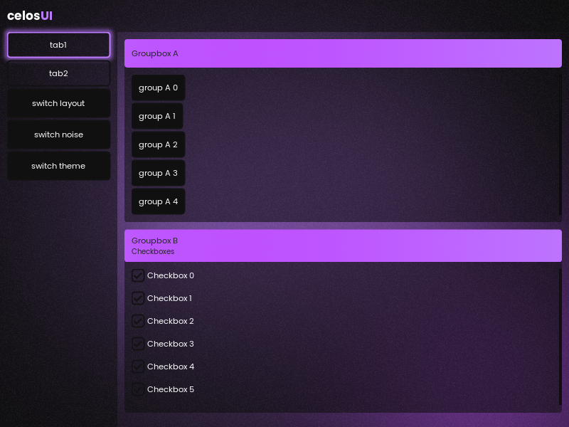

# CelosUI
A heavily modified version of ImGui with added functionality.

## Current features
* All of the ImGui features
* Animations
* New and improved widgets and components
* Map variables
* Automatic layouts
* Win32 windows and effects
* Custom theme support, dark and light themes with eased switching
* DirectX 11 (Windows) and Vulkan (Linux)
* Shader effects
* New font system, rendered with FreeType
* Images compiled into the executable
* Tabs
* InputSystem

## To implement
* Button Layout (Tabs)
* Color Picker
* Scrollbar.h

## Optional
* redo font spacing code
* redo imgui::endchild pushclip, combo pushclip, begin pushbclip
* RenderFrameFunctions
* for animations using renderframeanimations, add an index that is reset on every frame to avoid mixing up

## Building
**Windows (Visual Studio):** open `cUI.sln` and build. This uses Win32 + DirectX 11.

**CMake (Windows and Linux):**
```
cmake -S . -B build
cmake --build build --config Release
```
CMake picks the backend with `CELOSUI_PLATFORM`:
* `win32`: Win32 + DirectX 11, the default on Windows. It's the only backend where the OS can blur the desktop behind the window, the others use the shader background.
* `glfw`: GLFW + Vulkan, the default on Linux (it also builds on Windows). GLFW, the Vulkan headers and [volk](https://github.com/zeux/volk) are downloaded while configuring, so Vulkan only has to be installed as a driver.

On Linux you need a compiler, CMake, the X11 development packages and a Vulkan driver. On Debian/Ubuntu:
```
sudo apt install build-essential cmake libx11-dev libxrandr-dev libxinerama-dev libxcursor-dev libxi-dev glslang-tools mesa-vulkan-drivers
```
The window runs through X11 (XWayland on Wayland desktops), because Wayland doesn't let windows move themselves or stay on top. `-DCELOSUI_WAYLAND=ON` additionally builds GLFW's native Wayland support, which also needs `libwayland-dev libxkbcommon-dev wayland-protocols`.

The fonts and images in `assets/` are compiled into the executable through `ui/resources/font_data.cpp` and `ui/resources/image_data.cpp`, so nothing is loaded from disk. After changing or adding one (the list is at the top of the script), regenerate those files with `cmake -P ui/resources/embed_resources.cmake`. Each font is added with `resources::fonts::add(name, { data, size, pixels, hinting })` and looked up with `resources::fonts::get(name)`. Images are PNGs, decoded with [stb_image](https://github.com/nothings/stb) (`external/stb/`, built for PNG only and without file access) and uploaded as textures by `resources::images::add(name, data, size)` once the window exists. `ImGui::image(name, size, rounding)` draws one as an item, `resources::images::get(name).texture` works with any ImGui image function.

[FreeType](https://freetype.org) rasterizes the fonts. It's downloaded while building (CMake) or before the first build (Visual Studio, into `.deps/`), its hash is checked, and only the modules for TrueType and OpenType fonts are compiled.

Shaders (`ui/shaders/*.hlsl`, and ImGui's D3D11 shaders next to its backend) are compiled at build time and embedded as well, nothing is compiled at runtime. Visual Studio and the Windows CMake build use `fxc` from the Windows SDK, the Linux build uses `glslangValidator` from `glslang-tools` (the GLFW build on Windows takes it from the Vulkan SDK).

## Effects
Shader effects that draw into any ImGui draw list, in `celosia::effects` (`ui/ui.h`). Each shader is written once in HLSL and compiled for both D3D11 and Vulkan.
* `gradient`: two color gradient with exact rounded corners, optionally sliding back and forth (groupbox titles)
* `glow`: soft glow around an item (the active tab, hovered buttons)
* `blur`: frosted glass, blurs what was drawn before it and tints it (the combo popup, and the panels with the shader background)
* `background`: blobs of color drifting over a base color, the window background when `style::window::background` is `shader`
* `noise`: film grain that lightens and darkens pixels at random, static or changing 24 times a second. `style::window::noise` sets how strong it is over the window background, the panels and the combo popup (0 turns it off)

`style::window::background` picks between the OS blurring the desktop behind the window (`blur`, Windows only) and the shader background (`shader`, the default where the OS can't blur). "switch background" in the demo switches between them. The shader background also makes rounded window corners work (`style::general::rounding_window`). The blur only sees what the UI itself drew, not the desktop behind the window.

Debug builds report graphics API misuse: on Windows the D3D11 debug layer's messages are printed to the console (needs the "Graphics Tools" optional Windows feature), and for Vulkan run with `VK_INSTANCE_LAYERS=VK_LAYER_KHRONOS_validation` (the `vulkan-validationlayers` package on Linux).

## Using it in other software
FreeType is used under the FreeType License, which asks for a credit in the documentation of software that ships it, e.g. "Portions of this software are copyright (c) 2026 The FreeType Project (https://freetype.org). All rights reserved."

The demo's Windows release build doesn't load DLLs from next to the executable, so a DLL someone places there (e.g. in Downloads) can't run inside it. Software using the UI should do the same:
* call `SetDefaultDllDirectories(LOAD_LIBRARY_SEARCH_SYSTEM32)` first thing in `main`, see `main.cpp`
* link the C runtime statically (`/MT`) and pass `/DEPENDENTLOADFLAG:0x800` to the linker, see `cUI.vcxproj` or `CMakeLists.txt`

Release builds also turn on Control Flow Guard (`/guard:cf`) and CET shadow stack support (`/CETCOMPAT`). On Linux the CMake build asks for the usual hardening (stack protector, fortify, full RELRO, non-executable stack, PIE) instead of relying on the compiler defaults.

## Known issues
* Rounding a window that uses the OS blur gives weird looking edges, use the shader background for rounded windows (see Effects)



To find todo's, search all files for "CTODO". This was in order to prevent ImGui's todos from interfering with my own.
