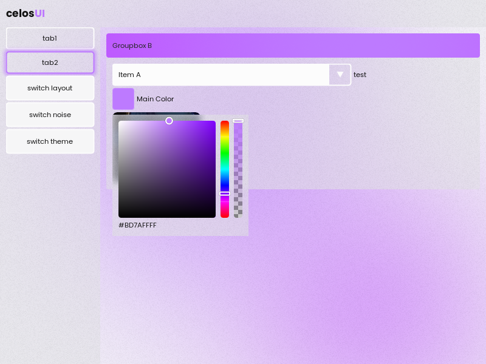
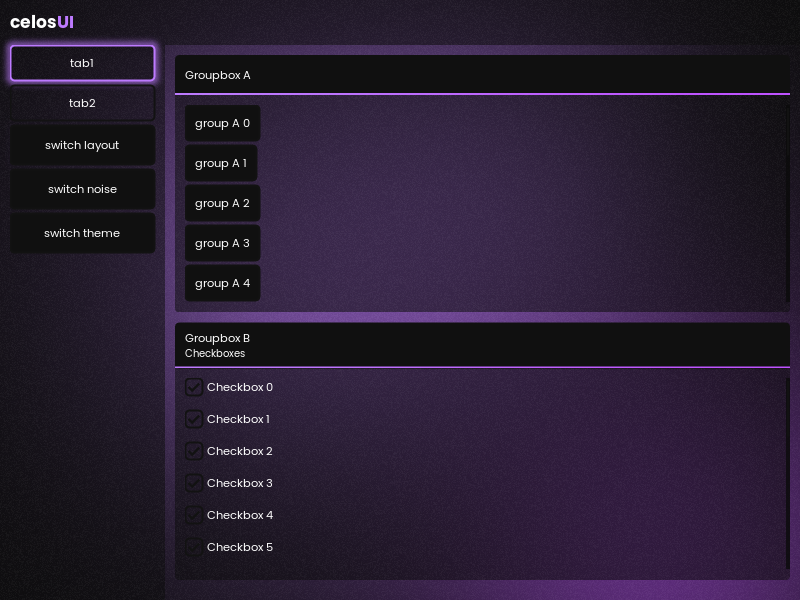
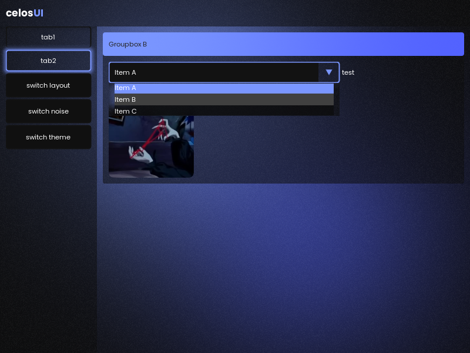

# CelosUI
A C++ UI framework for Windows (Win32 + DirectX 11) and Linux (GLFW + Vulkan). Dear ImGui's immediate mode core does the layout and input underneath; on top of it CelosUI has its own widgets, themes, animations, shader effects, font and image handling, and the window itself.

| | |
|---|---|
|  |  |
| Dark theme | Light theme, color picker open |
|  |  |
| Minimal groupbox titles | A blue main color, combo open |

## Features
* Everything ImGui has underneath (layout, input, IDs, child windows, the whole widget API)
* Animations that step evenly whatever the frame rate
* New and improved widgets: buttons, checkboxes, combo, color picker (`widgets::color_edit`), slider (`widgets::slider_float`), images (`widgets::image`), tab buttons, groupboxes
* Tabs that lay themselves out (`render::tabs`, vertical or horizontal)
* Map variables: widgets that keep their value in `variables::config` by label (`widgets::checkbox_map`)
* Themes: dark and light, eased between when switched
* Shader effects: gradients, glow, frosted glass blur, an animated background and film grain
* Borderless, translucent window with the OS blur behind it (Windows, KDE Plasma on Linux) or the shader background
* Fonts rendered with FreeType, fonts and images compiled into the executable
* Smooth scrolling
* Scales with the display: `platform::create()` sizes the window, fonts and style to the monitor's DPI (`style::scale`)
* Input system with per-frame key presses and releases
* DirectX 11 (Windows) and Vulkan (Linux)

## Building
**Windows (Visual Studio):** open `cUI.sln` and build. This uses Win32 + DirectX 11.

**CMake (Windows and Linux):**
```
cmake -S . -B build
cmake --build build --config Release
```
CMake picks the backend with `CELOSUI_PLATFORM`:
* `win32`: Win32 + DirectX 11, the default on Windows. The OS blurs the desktop behind the window here and with `glfw` on KDE Plasma, everywhere else the shader background is used.
* `glfw`: GLFW + Vulkan, the default on Linux (it also builds on Windows). GLFW, the Vulkan headers and [volk](https://github.com/zeux/volk) are downloaded while configuring, so Vulkan only has to be installed as a driver.

On Linux you need a compiler, CMake, the X11 development packages and a Vulkan driver. On Debian/Ubuntu:
```
sudo apt install build-essential cmake libx11-dev libxrandr-dev libxinerama-dev libxcursor-dev libxi-dev glslang-tools mesa-vulkan-drivers
```
The window runs through X11 (XWayland on Wayland desktops), because Wayland doesn't let windows move themselves or stay on top. `-DCELOSUI_WAYLAND=ON` additionally builds GLFW's native Wayland support, which also needs `libwayland-dev libxkbcommon-dev wayland-protocols`.

GLFW is patched after it's downloaded (`external/glfw_patch/argb_visual.cmake`) so its Vulkan windows on X11 get a visual with an alpha channel, which lets a compositor show the desktop through the window. When KWin (KDE Plasma) can blur, it's asked to blur behind the window through its `_KDE_NET_WM_BLUR_BEHIND_REGION` hint, on Plasma's X11 session and through XWayland on its Wayland session. Other compositors have no way for a window to ask for it (picom and Hyprland blur translucent windows from their own config), so they get the shader background.

[FreeType](https://freetype.org) rasterizes the fonts. It's downloaded while building (CMake) or before the first build (Visual Studio, into `.deps/`), its hash is checked, and only the modules for TrueType and OpenType fonts are compiled.

Shaders (`ui/shaders/*.hlsl`, and ImGui's D3D11 shaders next to its backend) are compiled at build time and embedded as well, nothing is compiled at runtime. Visual Studio and the Windows CMake build use `fxc` from the Windows SDK, the Linux build uses `glslangValidator` from `glslang-tools` (the GLFW build on Windows takes it from the Vulkan SDK).

## The demo
The demo window is `render::main_window()` in `ui/render/main_window.cpp`, with the sidebar's tabs in `ui/render/sidebar.cpp`:
* **Widgets**: buttons, checkboxes, a combo, a slider and a toggle, and an image, in a 2x2 grid of groupboxes
* **Appearance**: a settings page for the look, presets first and the picker and sliders for going further, all only as far as `style::limits` lets them (see Effects)
  * Style: the theme (dark or light), the accent (a row of presets and the color picker, it changes the accent everywhere), the groupbox title style (`style::groupbox::title_style`, full or minimal, the theme leaves it as it is) and the film grain
  * Glass: the background (the OS blur or the shader background, only where the OS can blur: Windows, and KDE Plasma on Linux), the glass presets (clear, frosted, solid), a slider for how strong the frosted glass blurs and one for how much the window covers the desktop with the OS blur

## Using it
`main.cpp` is the whole loop:
```cpp
celosia::initialize::context();
if (!celosia::platform::create("Celosia UI", ImVec2(0, 0), celosia::ui::size))
    return 1;
celosia::initialize::fonts();  // sized for the monitor create() scaled the ui to
celosia::initialize::images(); // textures need the window

while (celosia::platform::poll()) {
    celosia::ui::render(); // draws render::main_window(), put your own window there
    celosia::platform::bring_to_top();
}

celosia::platform::destroy();
ImGui::DestroyContext();
```
Inside the window, the widgets are used like normal ImGui ones:
```cpp
render::groupbox::begin("Groupbox B", "Checkboxes"); // stacked two to a tab, or render::groupbox::fullscreen / four (a 2x2 grid) as the 3rd argument
widgets::checkbox_map("Checkbox 0");             // value lives in variables::config::bools["Checkbox 0"]
widgets::color_edit("Main Color", color);        // float[4]
widgets::slider_float("Size", &size, 0.f, 10.f); // float, dragged between 0 and 10
widgets::image("test", ImVec2(0, 0), 8.f);       // 0, 0 is the image's own size
render::groupbox::end();
```
Where things are:
* `ui/ui.h`: the public namespaces (`platform`, `effects`, `resources`, `animations`, `variables`, ...)
* `ui/render/`: the window parts (titlebar, sidebar, tabs, groupboxes, panels, text)
* `ui/wrappers/`: our widgets (`celosia::widgets`, `wrappers.h`) and the ImGui widgets we replaced (ButtonEx, Checkbox, Combo, Selectable, Scrollbar), in `imgui/`
* `ui/style/`: style values, themes, accents and animations
* `ui/win32/` and `ui/glfw/`: the two platform layers (window, device, textures, effects)
* `ui/shaders/`: the effect shaders
* `ui/resources/`: fonts and images compiled into the binary
* `external/`: ImGui and its backends, stb_image, the FreeType config

## Fonts and images
The fonts and images in `assets/` are compiled into the executable through `ui/resources/font_data.cpp` and `ui/resources/image_data.cpp`, so nothing is loaded from disk. After changing or adding one (the list is at the top of the script), regenerate those files with `cmake -P ui/resources/embed_resources.cmake`.

Each font is added with `resources::fonts::add(name, { data, size, pixels, hinting })` (pixels at 96 DPI, scaled by `style::scale`, so add fonts after `platform::create()`) and looked up with `resources::fonts::get(name)`, which falls back to the default font. Images are PNGs, decoded with [stb_image](https://github.com/nothings/stb) (`external/stb/`, built for PNG only and without file access) and uploaded as textures by `resources::images::add(name, data, size)` once the window exists. `widgets::image(name, size, rounding)` draws one as an item, `resources::images::get(name).texture` works with any ImGui image function.

## Effects
Shader effects that draw into any ImGui draw list, in `celosia::effects` (`ui/ui.h`). Each shader is written once in HLSL and compiled for both D3D11 and Vulkan.
* `gradient`: two color gradient with exact rounded corners, optionally sliding back and forth (groupbox titles)
* `glow`: soft glow around an item (the active tab, hovered buttons)
* `blur`: frosted glass, blurs what was drawn before it and tints it (the combo and color picker popups, and the panels with the shader background). `style::window::glass_blur` is its radius there
* `background`: blobs of color drifting over a base color, the window background when `style::window::background` is `shader`
* `noise`: film grain that lightens and darkens pixels at random, static or changing 24 times a second. `style::window::noise` sets how strong it is over the window background, the panels and the combo popup (0 turns it off)

`style::window::background` picks between the OS blurring the desktop behind the window (`blur`, Windows and KDE Plasma) and the shader background (`shader`, the default where the OS can't blur). The shader background also makes rounded window corners work (`style::general::rounding_window`). With KWin's blur the blurred area follows the rounding too. The blur effect only sees what the UI itself drew, not the desktop behind the window. How strongly the OS blurs is up to the OS, `style::window::glass_opacity` sets how much the window's background and panels cover it (1 is the theme's own alpha).

`style::limits` sets how far the values a user can change may go: how grey and how dark the main color, how little and how much glass blur, how little glass opacity and how much noise. Past those the window stops working: a black or grey accent hides the groupbox titles, checkmarks and logo, bare glass loses the text against a bright desktop (or a dark one with the light theme), and too little blur shows the text behind a popup through its own. `style::keep_in_limits()` (called by `style::apply()` every frame) brings the values back into them whatever set them, and keeps the main color opaque. `widgets::color_edit()` and `color_picker()` take a saturation and value minimum, their square then only spans the colors above them.

`style::presets` has the choices a user picks from first, all inside the limits: `accents` (`widgets::swatches()` shows them as a row of round swatches) and `glass` (blur and opacity together, `presets::set_glass()` sets one and `presets::glass_current()` says which one the window is on, -1 once the sliders moved it off them; the demo shows them with `widgets::segmented()`, a row of choices in one frame). `noise` is how strong the film grain is when it's on, the demo switches it with `widgets::toggle()`.
What the user picks is `style::general::main_color`, what's drawn is `style::general::accent`: the same color, mixed towards white or black where it would blend into the theme's background (`style::limits::accent_contrast_min`, worked out by `style::themes::readable()`), so a yellow turns olive on the light theme and a deep blue lighter on the dark one. The groupbox title text is dark or white, whichever stands out more from the title bar. With the OS blur a theme's `glass_floor` is the least of the desktop its glass covers (`style::window::glass_cover()` goes from it up to 1 as `glass_opacity` does), the light theme's keeps it light over a dark desktop.

Debug builds report graphics API misuse: on Windows the D3D11 debug layer's messages are printed to the console (needs the "Graphics Tools" optional Windows feature), and for Vulkan run with `VK_INSTANCE_LAYERS=VK_LAYER_KHRONOS_validation` (the `vulkan-validationlayers` package on Linux).

## Using it in other software
Licenses of what gets compiled in:
* FreeType: the FreeType License, which asks for a credit in the documentation of software that ships it, e.g. "Portions of this software are copyright (c) 2026 The FreeType Project (https://freetype.org). All rights reserved."
* Poppins (the fonts in `assets/`): SIL Open Font License 1.1, its license text has to be shipped with the software
* stb_image: public domain or MIT

The demo's Windows release build doesn't load DLLs from next to the executable, so a DLL someone places there (e.g. in Downloads) can't run inside it. Software using the UI should do the same:
* call `SetDefaultDllDirectories(LOAD_LIBRARY_SEARCH_SYSTEM32)` first thing in `main`, see `main.cpp`
* link the C runtime statically (`/MT`) and pass `/DEPENDENTLOADFLAG:0x800` to the linker, see `cUI.vcxproj` or `CMakeLists.txt`

Release builds also turn on Control Flow Guard (`/guard:cf`) and CET shadow stack support (`/CETCOMPAT`). On Linux the CMake build asks for the usual hardening (stack protector, fortify, full RELRO, non-executable stack, PIE) instead of relying on the compiler defaults.

## Known issues
* Rounding a window that uses the Windows blur gives weird looking edges, use the shader background for rounded windows (see Effects)
* On X11 without a compositor the window isn't see-through, the parts that should be (like rounded corners) are black
* The UI keeps the scale of the monitor it opened on, moved to a monitor with a different scale it isn't resized

## TODO
* redo the clip rect workarounds: ImGui clips a window's contents one pixel in from its edges, so the window background, the combo popup and the color picker popup push their own clip rect to draw up to the edge

To find todos in the code, search all files for "CTODO". This keeps them apart from ImGui's own todos.
